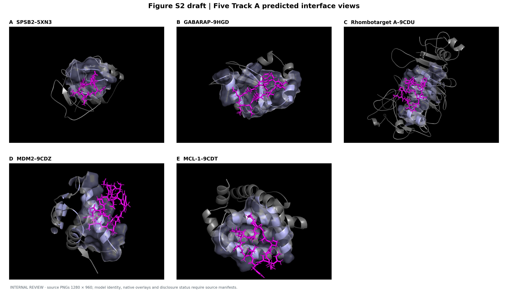
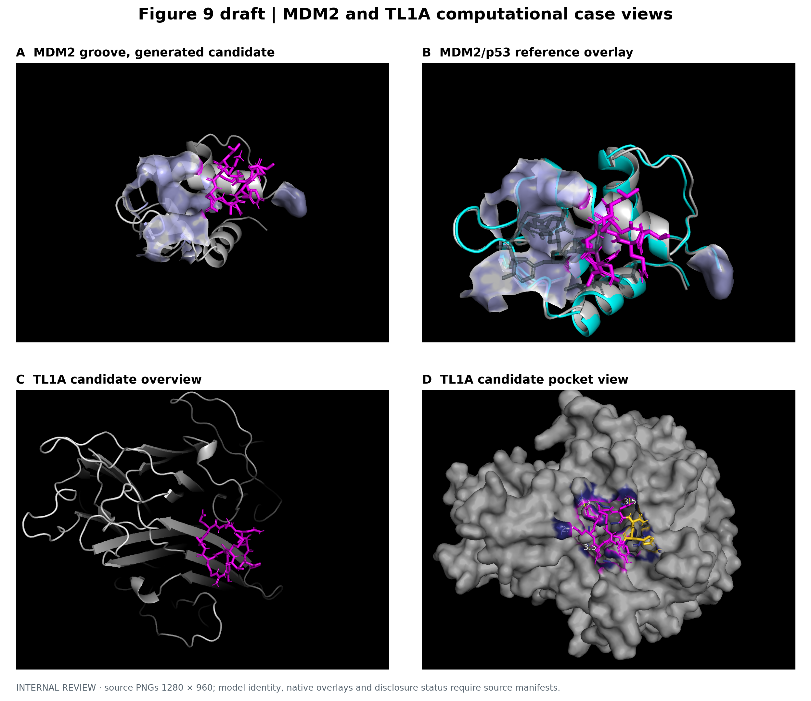
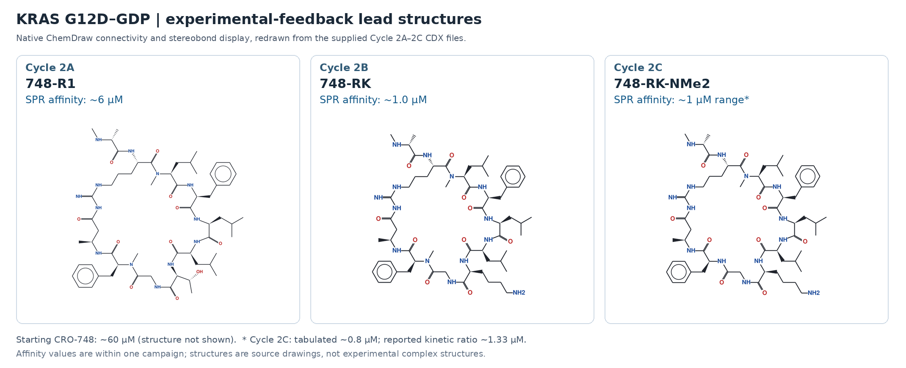

# CP-GFM-SGX Technical Report

## Topology-aware cyclic-peptide design, platform-specific comparison, and experimental KRAS feedback

**Public draft · 14 October 2026**  
**Companion to:** [CP-GFM public interface](https://github.com/YulixirAI/CP-GFM) and [CP-GFM-SGX ChemRxiv preprint, version 1](https://doi.org/10.26434/chemrxiv.15010253/v1)  
**Figure assets:** Keep the `assets/` directory alongside this Markdown file when adding it to GitHub.

> **Scope of this report.** We compare the scientific tasks and publicly documented evidence of CP-GFM-SGX, Vilya-2/Riptides, Latent-X, AlphaProteo, BoltzGen, and Chai-2. We describe our disclosed structural evaluations and a separate KRAS G12D–GDP experimental feedback series through Cycle 2C. This is a platform-level technical comparison, not a common-target, common-budget head-to-head benchmark. The public CP-GFM repository exposes a scientific interface and illustrative examples; its toy runtime does not reproduce the experimental campaign or the complete research system.

## Abstract

We developed CP-GFM-SGX to connect cyclic-peptide generation with explicit ring topology, chemical identity, receptor-conditioned structural evaluation, and a traceable decision record. Our frozen five-complex known-ligand evaluation selected a backbone pose below 2 Å in four of five systems without using native ligand coordinates for selection; a retrospective best-of-100 pose fell below 2 Å in all five. In a separate seven-target de novo analysis, matched true-pocket and shuffled-pocket computational comparisons favored the specified pocket in all seven reported targets. Controlled fault-injection tests evaluated how candidate evidence, provenance, failure states, and resource budgets affect progression. These experiments answer different questions and do not constitute a measured de novo binding hit rate. We also report an independently scoped KRAS G12D–GDP synthesis and binding campaign in which assay results guided successive design decisions from an approximately 60 µM starting point to approximately 1 µM by Cycle 2B; Cycle 2C explored a further chemical modification, with assay-dependent estimates near this affinity range. We place these results alongside the distinct achievements of current interface-prediction, macrocycle-design, general binder-design, and antibody-design systems. This comparison identifies where direct benchmarking is possible and where differences in molecular modality, cyclization chemistry, selection budget, or endpoint prevent a numerical ranking.

## 1. What we built and what the public repository provides

Our design problem starts with a target receptor state and a specified binding region. A candidate must carry more than a peptide sequence or an attractive pose: its declared ring-closing bond, atom and residue identities, stereochemistry and allowed chemistry, receptor context, structural evidence, and decision history must refer to the *same* molecule. CP-GFM-SGX couples a topology-aware, receptor-conditioned generative route to downstream chemical and geometric checks, complex evaluation, ranking, and candidate-level evidence progression. In the research workflow, a candidate can advance only when the required evidence for that stage is present and consistent. See the [preprint](https://doi.org/10.26434/chemrxiv.15010253/v1) for the evaluation definitions and the [repository architecture](https://github.com/YulixirAI/CP-GFM/blob/main/docs/architecture.md) for the public interface contracts.

The public repository makes the *contract* inspectable: target context, topology specification, generator, gate, ranker, Pareto selection, oracle audit, and evidence object. It includes schemas and a synthetic toy demonstration. It does **not** release the trained research model, full target-specific pipelines, experimental raw data, or a production design service. We therefore attribute the scientific results below to the preprint and campaign, not to executing the repository's toy example. A computational nomination is a proposal for synthesis and testing; it is not a binding measurement.

## 2. Comparison method: match the question before comparing the number

We distinguish four endpoints: **known-ligand pose recovery**, where the peptide's identity is supplied; **de novo candidate generation**, where a new binder is proposed for a target; **experimental binding**, where a synthesized molecule is measured; and **evidence control**, where a workflow preserves identity, failures, and provenance. Numbers from different endpoints cannot be placed in a single performance ranking. Even within one endpoint, comparison requires the same target set, molecular class, receptor inputs, allowed chemistry, selection rule, sample budget, and metric implementation.

The table summarizes what the cited public sources establish. “Not assessed here” means that we have not reproduced a comparable measurement; it is **not** a claim that another platform lacks the capability.

| Platform | Principal task and molecule | Relevant public evidence | Relationship to our question |
| --- | --- | --- | --- |
| **CP-GFM-SGX** | Receptor-conditioned cyclic-peptide proposals with explicit topology, chemistry checks, structural evaluation, and candidate evidence state | Five-complex known-ligand recovery; seven-target computational pocket control; synthetic governance tests; separate KRAS synthesis/SPR–BLI feedback series | Direct evidence for our specified workflow; experimental KRAS results are separate from the frozen structural panels. [Preprint](https://doi.org/10.26434/chemrxiv.15010253/v1); [interface](https://github.com/YulixirAI/CP-GFM) |
| **Vilya-2 / Riptides** | Chemically diverse peptide–target and other molecular-interface **structure modeling**; Riptides provides benchmark inputs and evaluation code | Vilya-2 reports peptide-interface recovery; Riptides supplies receptor PDB/ligand SDF inputs, RMSD calculations, and validity checks | Strong reference for external pose modeling. A Riptides result would require running our method on its full eligible set under its evaluator; our five-case panel is not that result. [Vilya-2](https://arxiv.org/abs/2607.25156); [Riptides](https://github.com/VilyaPublic/Riptides) |
| **Latent-X** | Joint all-atom sequence/structure design of macrocyclic peptides and protein mini-binders | Reports prospective macrocycle binding experiments and greater than 90% hits on its evaluated benchmark targets | Closest published experimental *macrocycle generation* comparison in this set, subject to matched chemistry, target selection, assay definition, and candidate budget. [Paper](https://arxiv.org/abs/2507.19375) |
| **BoltzGen** | Open, target-conditioned all-atom design across proteins and peptides, including cyclic-peptide specifications | Reports prospective peptide work, including disulfide-cyclized RagA:RagC binders measured by SPR | A particularly relevant wet-lab comparator, while its published cyclic-peptide assay uses an internal disulfide ring rather than our specified head-to-tail topology. [Paper](https://pmc.ncbi.nlm.nih.gov/articles/PMC12697729/); [code](https://github.com/HannesStark/boltzgen) |
| **AlphaProteo** | Target- and epitope-conditioned **protein** binder design | Reports experimental validation across protein targets | An important comparator for de novo target-specific binder discovery, outside a chemically matched small cyclic-peptide evaluation. [Paper](https://arxiv.org/abs/2409.08022) |
| **Chai-2** | Multimodal **antibody and nanobody** generation | Reports a 16% de novo antibody hit rate over 52 targets with at most 20 designs per target | Strong prospective antibody evidence; its hit rate does not measure head-to-tail cyclic-peptide design. [Paper](https://www.biorxiv.org/content/10.1101/2025.07.05.663018v1) |

### Vilya-2 and Riptides: a useful external pose benchmark

Vilya-2 addresses a task close to our known-ligand structural evaluation: modeling chemically diverse peptide–target interfaces using an all-atom diffusion representation and ensemble ranking. Its paper reports sub-2 Å peptide-interface recovery in 59.1% of its evaluated cases. Riptides publishes benchmark structures, example predictions, and evaluation code for full-atom/backbone RMSD and PoseBusters checks. We welcome that concrete external test surface. Our 4/5 Top-1 result uses a restricted head-to-tail panel, a defined 100-pose budget, and our frozen selection rule. The Vilya-2 percentage uses a different benchmark and protocol; **4/5 versus 59.1% is not a head-to-head comparison**. Vilya-2's primary public claim is structural modeling, while our report additionally examines candidate topology and evidence-controlled progression. These are complementary questions. [Vilya-2 paper](https://arxiv.org/abs/2607.25156) · [Riptides evaluation instructions](https://github.com/VilyaPublic/Riptides#running-the-benchmark)

### Latent-X: experimentally tested macrocycle generation

Latent-X jointly designs binder sequence and structure in a target context and reports prospective assays for macrocycles and mini-binders. Its macrocycle hit rates above 90% on the evaluated targets are substantial experimental evidence and should be recognized as such. Our current seven-target pocket comparison is a *computational* directional control; it cannot be reported as a competing hit rate. Our KRAS series instead demonstrates how one target-specific chemical campaign used measured results to revise subsequent choices. A fair experimental comparison would synthesize both systems' outputs against the same targets, specify compatible ring chemistry and assay thresholds, and count all nominated molecules. [Latent-X paper](https://arxiv.org/abs/2507.19375)

### BoltzGen: broad design and a directly relevant cyclic-peptide experiment

BoltzGen accepts target and binding-site specifications, generates and ranks binders, and documents cyclic-peptide design in its public protocol. Its paper reports a RagA:RagC campaign: 24 **disulfide-cyclized** peptides tested, 14 with detected binding, and SPR affinities resolved for eight, with a best reported value of approximately 80 µM in the version-1 paper. These results are genuine prospective cyclic-peptide evidence. Their cysteine-to-cysteine closure, target, and assay series differ from our head-to-tail KRAS campaign; an affinity or hit-rate ordering across those campaigns would be misleading. The published BoltzGen pipeline and code also offer a concrete baseline for a future same-input evaluation of design validity, ranking, and evidence export. [BoltzGen paper, Sections 2.5–2.6](https://pmc.ncbi.nlm.nih.gov/articles/PMC12697729/) · [protocol documentation](https://github.com/HannesStark/boltzgen#protocols)

### AlphaProteo and Chai-2: strong results in other binder classes

AlphaProteo demonstrates experimentally validated design of protein binders conditioned on a target and epitope. Chai-2 demonstrates prospective antibody/nanobody design across a broad target set. Both set a high standard for the number of targets tested and for connecting in silico design to wet-lab readouts. Their disclosed results do not establish performance for a small head-to-tail macrocycle with chemical graph and closure requirements. We include them because they clarify the wider target-specific design landscape and the experimental evidence a mature platform report should aspire to provide, not because their protein or antibody hit rates are convertible into cyclic-peptide metrics. [AlphaProteo paper](https://arxiv.org/abs/2409.08022) · [Chai-2 paper](https://www.biorxiv.org/content/10.1101/2025.07.05.663018v1)

## 3. CP-GFM-SGX evidence, with denominators kept separate

### Track A — known-ligand pose recovery

We froze a panel of five experimentally resolved, eligible head-to-tail cyclic-peptide complexes and scheduled 100 poses per complex. The supplied peptide identity was available to construction; experimental ligand coordinates and native contacts were excluded from prospective selection. After selecting the Top-1 pose using native-free evidence, we calculated ligand-backbone RMSD against the native structure. Four of five selected poses were below 2 Å (median Top-1 RMSD, 1.72 Å). Retrospective evaluation found a below-2 Å pose within the 100 scheduled samples in all five systems. **Best of 100 is a sampling ceiling, not a pose a prospective selector could identify with native knowledge.** In the remaining MCL-1 case, best-of-100 was 1.71 Å while selected Top-1 was 2.31 Å, a visible opportunity to improve selection. The small, eligibility-filtered panel supports a limited pose-recovery claim and calls for a larger external benchmark. [Preprint](https://doi.org/10.26434/chemrxiv.15010253/v1)

### The structural illustration plate: five interfaces, one quantitative reading

The manuscript's five-view structural plate places proposed cyclic-peptide conformations against the receptor surfaces of SPSB2, GABARAP, Rhombotarget A, MDM2, and MCL-1. It helps readers see that the evaluation concerns *target-associated three-dimensional poses*, not isolated peptide conformers. We interpret the images together with the frozen coordinate-based results below; the rendered proximity of a peptide to a receptor surface is not itself an RMSD measurement or evidence of binding.

**Figure 1. Five Track A interface views.** Magenta sticks show the rendered peptide and gray surfaces/cartoons show the receptor context in the supplied manuscript illustration. The original plate is marked “internal review.” Panel identity is based on its supplied labels; a coordinate manifest linking each panel to the frozen Top-1 record and an aligned native-peptide overlay were not available in the image bundle. The numerical pose-recovery results below come from the frozen evaluation, not measurement from these pixels.

| Illustrated complex | Native-free selected Top-1 l-RMSD | Native-evaluated best of 100 | What the comparison shows |
| --- | ---: | ---: | --- |
| SPSB2–5XN3 | 1.18 Å | 0.86 Å | Near-native pose was both sampled and selected. |
| GABARAP–9HGD | 1.56 Å | 1.15 Å | Native-free selection retained a sub-2 Å pose. |
| Rhombotarget A–9CDU | 1.83 Å | 1.39 Å | The selected pose met the prespecified recovery cutoff. |
| MDM2–9CDZ | 1.72 Å | 1.08 Å | Recovery is part of Track A; this same complex serves as *calibration*, not one of Track B's seven main targets. |
| MCL-1–9CDT | 2.31 Å | 1.71 Å | Sampling found a sub-2 Å pose, while native-free ranking did not choose it. |

All l-RMSD values are after receptor superposition. We use the **numeric evaluation**, rather than visual overlap in Figure 1, for the 4/5 Top-1 and 5/5 best-of-100 conclusions. [Preprint, Track A structural illustration plate](https://doi.org/10.26434/chemrxiv.15010253/v1)

### Track B — de novo computational pocket control

We evaluated proposed candidates against the specified receptor pocket and a matched shuffled-pocket control on seven reported main targets. The true-minus-shuffled computational score direction favored the specified pocket in all seven; the median of the reported target medians was +172.6 Rosetta energy units (REU), with the weakest target at +3.9 REU. This is evidence of *pocket preference under that oracle and control construction*. It is not a binding free energy, a binding constant, or proof that all selected molecules bind in the laboratory. A common post-protocol assessor admitted 42/42, 42/42, and 40/42 selected top-K slots in the full, condition-masked, and post hoc head-to-tail arms, respectively. Because those are selected-slot denominators and the assessor was exploratory, they do not establish an end-to-end raw-proposal yield advantage. [Preprint](https://doi.org/10.26434/chemrxiv.15010253/v1)

**Figure 2. MDM2 and TL1A computational case views.** Panels A–B illustrate an MDM2 candidate and a receptor/reference overlay; panels C–D illustrate a TL1A candidate from whole-target and pocket perspectives. The source image is marked “internal review,” and its candidate structures have no supplied panel-to-coordinate manifest. MDM2–9CDZ contributes to Track A and is a Track B calibration case; TL1A is a supporting computational case. Neither enters the seven-target Track B pocket-preference denominator. These views illustrate target context, rather than independently validating binding or reporting an additional benchmark result.

### Track C — evidence progression under controlled faults

We tested the evidence-state controller against deterministic synthetic cases including missing required chemistry evidence, stale target assets, duplicate events, interruption/retry, oracle failure, and budget overrun. The complete controller produced the specified protective outcomes in the reported fixtures; targeted ablations help identify the relevant guards. These are *controlled workflow tests*, not a measured historical rate of laboratory or production failures. The practical point is that a candidate should retain its molecular identity, receptor context, failed measurements, and decision provenance as it moves from proposal to nomination. [Preprint](https://doi.org/10.26434/chemrxiv.15010253/v1) · [public evaluation protocol](https://github.com/YulixirAI/CP-GFM/blob/main/docs/evaluation_protocol.md)

## 4. Wet-lab validation: KRAS G12D–GDP design–synthesis–measurement feedback

The KRAS campaign is a separate target-scoped case study. We used synthesis, analytical release, SPR binding measurements, and selected orthogonal BLI checks to turn candidate proposals into experimentally informed decisions. A starting ligand, CRO-748, gave an approximately 60 µM affinity estimate. Rather than discard unfavorable variants, we used their measured behavior to test successive chemical hypotheses. The campaign does not supply a prospective binding hit rate for the frozen Track A–C panels. [Preprint](https://doi.org/10.26434/chemrxiv.15010253/v1)

### Cycle 2A: establish a useful cationic anchor

We tested three position-2 alternatives around the CRO-748 scaffold. The Arg-bearing **748-R1** gave approximately 6 µM by SPR, with a BLI estimate in the same range, representing an approximately tenfold within-campaign improvement over CRO-748. The shorter cationic Dab variant was weaker (~27 µM), while the neutral citrulline variant (~55 µM) was close to the parent. These comparisons justified advancing the Arg-containing series and deprioritizing the neutral substitution. They support an association between the tested side-chain choices and affinity; an SPR/BLI measurement alone does not establish a specific atomic salt bridge. The three tested compounds passed the reported HPLC/HRMS release criteria, with additional NMR confirmation for the Arg and Dab products.

### Cycle 2B: test charge placement and aromatic substitutions

We then measured eight variants of the 748-R1 series. **748-RK**, with separated Arg2 and Lys7 side chains, gave the best reported SPR estimate of approximately 1.0 µM. Two other dual-cation designs, **748-Orn2** (~1.4 µM) and **748-R2** (~2.5 µM), also improved on the single-Arg parent (~6 µM). By contrast, changing the position of the single Arg gave estimates of ~7–9 µM, and the Trp- and 1-naphthyl-containing variants were weaker at approximately 10 and 14 µM. Within this tested scaffold and assay, the dual-cation and spacing hypotheses proved more productive than the aromatic branch. The result guided selection of 748-RK as the next parent; it does not by itself prove a unique binding orientation or electrostatic mechanism.

### Cycle 2C: probe a narrower affinity range

We used 748-RK as the reference and tested three further designs: a triple-cation variant, an Arg/Lys position swap, and **748-RK-NMe2**, which reduced the backbone N-methylation count by one. The report lists approximately 0.8 µM for 748-RK-NMe2 and BLI estimates of approximately 0.6–1.2 µM. However, its reported kinetic constants (k_off = 0.20 s⁻¹; k_on = 1.5 × 10⁵ M⁻¹ s⁻¹) imply **K_D ≈ 1.33 µM**. The reference 748-RK is approximately 1.0 µM, and the position-swapped analog is approximately 1.3 µM. We therefore describe Cycle 2C as exploration **around the 1 µM range**, without claiming a resolved improvement for NMe2. The triple-cation candidate lacks a clean 1:1 kinetic fit in the supplied result; a qualitative “sub-µM” label is not a reliable quantitative K_D and is excluded from fold-improvement calculations.

**Figure 3. Molecular structures anchoring the KRAS experimental-feedback series.** We show the 2A Arg-containing lead 748-R1, the 2B dual-cation lead 748-RK, and the 2C NMe2 variant. The connectivity and wedge display were redrawn from the three supplied ChemDraw CDX files; the 2A lead matches the repeated 2B reference molecular graph, and the 2B lead matches the 2C reference molecular graph. These are two-dimensional chemical drawings, not structures measured in a KRAS complex. The 2C label is deliberately an approximate affinity *range*: the assay table states ~0.8 µM, while its kinetic constants give ~1.33 µM. The starting CRO-748 structure is not shown. We retain other SAR observations in the table below without treating every unverified source drawing as a release-ready chemical identity.

| Round and comparison | Representative reported SPR K_D | What changed in our next decision |
| --- | ---: | --- |
| Initial CRO-748 | ~60 µM | Provided a measurable parent for focused SAR. |
| 2A: 748-R1 (Arg2); Dab and Cit comparators | ~6 µM; ~27 and ~55 µM | Advanced the Arg-containing series; retained weaker and near-parent results as evidence. |
| 2B: 748-RK (Arg2 + Lys7); Orn2 and R2 comparators | ~1.0 µM; ~1.4 and ~2.5 µM | Selected a separated dual-cation parent; deprioritized weaker aromatic substitutions. |
| 2C: 748-RK-NMe2; position swap; triple-cation design | Tabulated ~0.8 µM (kinetic ratio ~1.33 µM); ~1.3 µM; no clean fit | Tested backbone H-bond-donor and charge-placement hypotheses; held the potency conclusion near ~1 µM. |

The approximate 60-to-1 µM comparison represents a **roughly 60-fold improvement in selected, measured leads through Cycle 2B**. The series is especially informative because measurements redirected chemistry: a neutral position-2 substitution failed to reproduce the Arg effect, dual-cation designs outperformed the single-Arg parent in the tested set, and Cycle 2C exposed a limit of what closely spaced assay estimates can resolve. This is our disclosed design–test–learn example. It is a within-target SAR trajectory, not a de novo hit rate, a demonstration of fully autonomous optimization, or proof of cellular activity. Compound-level structures, assay traces, fit quality, and uncertainty should accompany any more detailed public mechanistic or potency claim. [Preprint](https://doi.org/10.26434/chemrxiv.15010253/v1)

## 5. Interpretation and next comparisons

Our current evidence supports three concrete claims. First, in a defined limited panel, our known-ligand route generated and selected near-native head-to-tail cyclic-peptide poses. Second, in the reported de novo computational study, selected candidates favored their declared pockets under a matched control; experimental target engagement for that panel remains an open measurement. Third, the separate KRAS campaign shows that synthesis and SPR/BLI results can inform successive chemical choices and achieve a meaningful improvement in measured affinity within the disclosed rounds. Evidence-state controls make those choices auditable across molecular, computational, and assay representations.

This combination is the reason we are making the CP-GFM interface public. The design record should tell a future user *which molecule was proposed, which ring was actually specified, which receptor and pocket were used, which checks passed or failed, what was measured, and why a candidate was advanced*. It also makes unfavorable results useful without disguising them as successes. Other systems have compelling strengths: Vilya-2 offers a valuable structural benchmark, Latent-X and BoltzGen report relevant prospective macrocycle or cyclic-peptide experiments, and AlphaProteo and Chai-2 demonstrate breadth in protein and antibody modalities. We intend the public interface to enable precise comparison and collaboration across these different tasks.

For a genuine prospective comparison, we would freeze a shared target and receptor set, identify common eligible chemistry (including an explicit definition of the closure bond), set identical design and laboratory budgets, blind rank candidates, and publish every synthesized candidate and assay outcome. Pose modeling should be assessed with the same receptor/ligand inputs and RMSD evaluator, ideally including eligible [Riptides](https://github.com/VilyaPublic/Riptides) cases. Experimental design should report assay thresholds and censoring, failed syntheses, non-binders, replicate uncertainty, and the denominator from proposals to tested molecules. A separate controller audit can then compare provenance and failure behavior without turning documentation coverage into an affinity score.

## 6. Availability

The [CP-GFM repository](https://github.com/YulixirAI/CP-GFM) contains the public interface, schemas, documentation, and toy demonstration. The [ChemRxiv version-1 preprint](https://doi.org/10.26434/chemrxiv.15010253/v1) is the scientific citation for the associated evaluation and KRAS results. The research implementation, weights, complete target-specific experimental records, and a production API are not distributed through the toy repository. Public claims in this report should be read at the level of the disclosed scientific results, with the preprint's methods and source data controlling any finer interpretation.

## Cite this work

If you use the public interface or refer to the associated scientific results, please cite **both** the [CP-GFM repository](https://github.com/YulixirAI/CP-GFM) and the preprint: *CP-GFM-SGX: Topology-Aware Cyclic Peptide Generation and Design with Receptor-Conditioned Structural Evaluation and Experimental KRAS Affinity Optimization*, ChemRxiv, version 1, [doi:10.26434/chemrxiv.15010253/v1](https://doi.org/10.26434/chemrxiv.15010253/v1).
